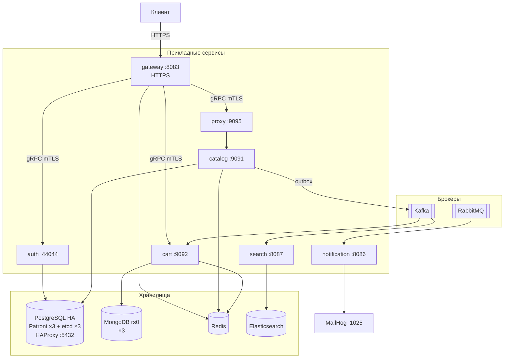
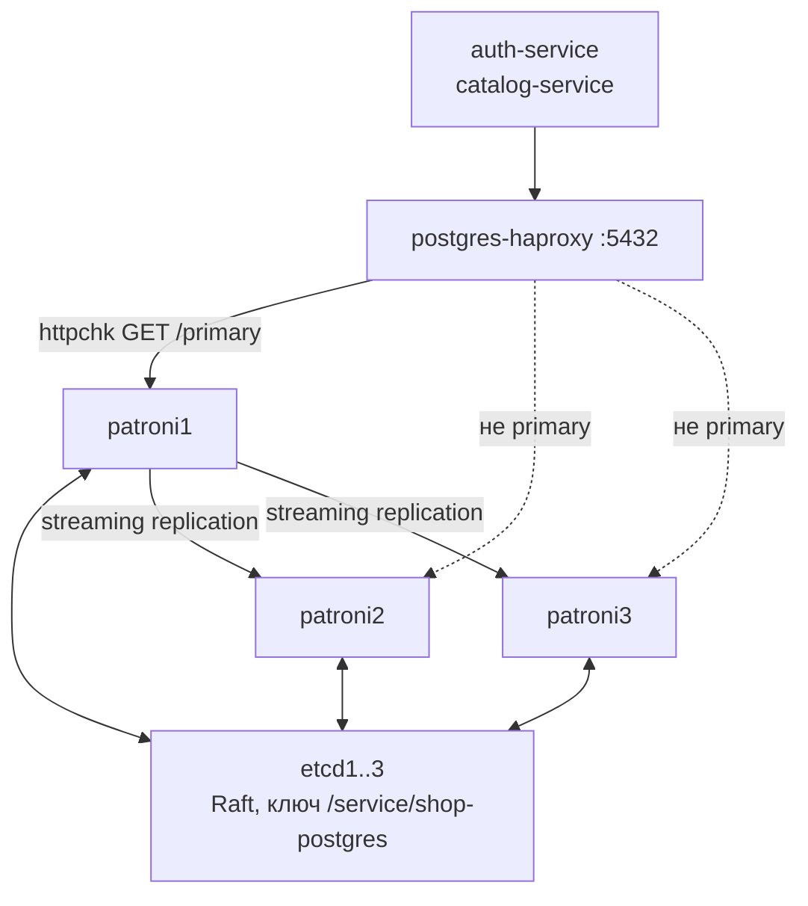
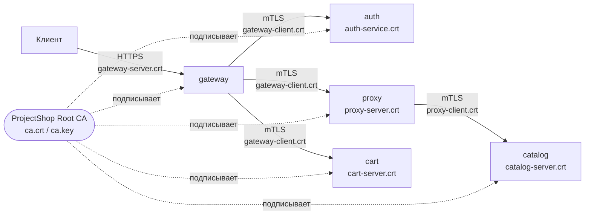
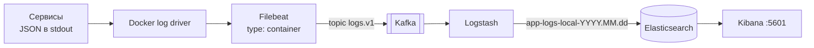

# shop-platform

Инфраструктурный репозиторий: docker-compose стенд, конфигурации хранилищ и observability-стека, генерация сертификатов, нагрузочный сценарий.

Собственного приложения не содержит — собирает остальные восемь репозиториев в работающую систему.

---

## Состав системы

Проект состоит из девяти независимых git-репозиториев, расположенных рядом друг с другом:

```text
ProjectShop/
├── shop-platform/          ← этот репозиторий: стенд и инфраструктура
├── shop-contracts/         ← proto, OpenAPI, схемы событий
├── shop-gateway-service/   ← внешний API gateway, HTTPS :8083
├── shop-auth/              ← аутентификация, gRPC :44044 / HTTP :8082
├── shop-catalog-service/   ← каталог, gRPC :9091 / HTTP :8081
├── shop-cart/              ← корзина, gRPC :9092 / HTTP :8084
├── shop-proxy/             ← TCP-прокси, :9095 / admin :8085
├── shop-notification/      ← уведомления, HTTP :8086
└── shop-search/            ← поиск, HTTP :8087
```

Compose-файлы ссылаются на соседние каталоги через относительные пути (`../../shop-auth`), поэтому структура обязательна: репозитории должны лежать в одной родительской директории.

Каждый сервис документирован в своём README. Начать удобно с [`shop-gateway-service`](../shop-gateway-service/README.md) — он точка входа — и [`shop-contracts`](../shop-contracts/README.md), где описаны контракты между всеми.

---

## Топология



Наружу опубликован только `gateway:8083`. Остальные сервисы доступны внутри сети стенда и требуют клиентский сертификат.

---

## Что поднимается

### Прикладные сервисы

| Сервис | Порты | Репозиторий |
|---|---|---|
| `gateway-service` | 8083 (HTTPS) | [shop-gateway-service](../shop-gateway-service) |
| `auth-service` | 8082, 44044 | [shop-auth](../shop-auth) |
| `catalog-service` | 8081, 9091 | [shop-catalog-service](../shop-catalog-service) |
| `cart-service` | 8084, 19092→9092 | [shop-cart](../shop-cart) |
| `proxy-service` | 8085, 9095 | [shop-proxy](../shop-proxy) |
| `notification-service` | 8086 | [shop-notification](../shop-notification) |
| `search-service` | 8087 | [shop-search](../shop-search) |

### Хранилища

| Компонент | Порты | Назначение |
|---|---|---|
`patroni1..3` | 15432, 25432, 35432 | PostgreSQL под управлением Patroni |
`etcd1..3` | 12379, 22379, 32379 | DCS для выборов лидера Patroni |
`postgres-haproxy` | 5432 | Единая точка входа, направляет в primary |
`mongo1..3` | 27017, 27018, 27019 | Replica set `rs0` для корзины |
`redis` | 6379 | Кэш каталога, rate limit, идемпотентность, мьютекс корзины |
`elasticsearch` | 9200 | Поисковый индекс и хранилище логов |

### Брокеры и почта

| Компонент | Порты |
|---|---|
`kafka` | 9092 |
`kafka-ui` | 8090 |
`rabbitmq` | 5672, 15672 (UI) |
`mailhog` | 1025 (SMTP), 8025 (UI) |

### Observability

| Компонент | Порт | Роль |
|---|---|---|
`prometheus` | 9090 | Сбор метрик |
`grafana` | 3000 | Дашборды и алерты |
`jaeger` | 16686, 4317/4318 (OTLP) | Трейсы |
`kibana` | 5601 | Просмотр логов |
`logstash` | — | Kafka → Elasticsearch |
`filebeat` | — | Docker-логи → Kafka |
`node-exporter` | 9100 | Метрики хоста |

### Разовые задачи

| Контейнер | Что делает |
|---|---|
`postgres-init` | Создаёт роли `auth_user`, `catalog_user` и базы `authdb`, `catalog` |
`auth-migrate` | Накатывает схему `authdb` |
`catalog-migrate` | Накатывает схему `catalog` |
`mongo-init` | Инициализирует replica set `rs0` |

---

## ⚠️ Три compose-файла и их пересечение

```text
deploy/
├── docker-compose.yml               # всё в одном: единственный брокер kafka,
│                                    # etcd+patroni+haproxy встроены, mongo, ELK,
│                                    # observability, все сервисы
├── docker-compose.brokers.yml       # кластер Kafka: kafka-1, kafka-2, kafka-3 + kafka-init
└── docker-compose.postgres-ha.yml   # etcd1..3, patroni1..3, postgres-haproxy
```

Это главная проблема стенда, и о ней нужно знать до первого запуска:

1. **`docker-compose.postgres-ha.yml` дублирует** секции `etcd1..3`, `patroni1..3` и `postgres-haproxy`, которые уже есть в основном файле. Запуск обоих файлов вместе приведёт к конфликту портов.

2. **Конфиги сервисов ждут брокеры, которых нет в основном файле.** `catalog`, `cart` и `search` настроены на `kafka-1:9092, kafka-2:9092, kafka-3:9092`, а `docker-compose.yml` поднимает один брокер с именем `kafka`. Поэтому при запуске «по документации» вся асинхронная часть не работает: каталог не публикует события, поиск не индексирует, корзина не помечает недоступные позиции. При этом сервисы отвечают `healthy` — сбой ничем не проявляется.

   Единственный потребитель брокера `kafka` — логи (`filebeat` → `kafka:9092` → `logstash`), и они работают.

Пока это не сведено к одному варианту, для работы событий нужно поднимать основной файл **вместе с** файлом брокеров и согласовывать имена.

---

## Быстрый старт

```bash
cd deploy
docker compose up -d --build
docker compose ps
```

Первый запуск занимает несколько минут: собираются семь образов, инициализируется кластер Patroni и replica set MongoDB.

Порядок запуска определяется зависимостями: `postgres-init` → `auth-migrate` / `catalog-migrate` → `auth-service` / `catalog-service` → `proxy-service` → `gateway-service`.

Если миграции не прошли (база ещё не была готова), их можно повторить:

```bash
docker compose up -d postgres-init auth-migrate catalog-migrate
```

### Сертификаты

mTLS требует сертификатов в `infra/certs`. Если каталог пуст:

```bash
./infra/certs/gen-certs.sh
```

Скрипт создаёт корневой CA и по паре ключ/сертификат на сервис. Генерировать нужно **до** первого запуска — сертификаты монтируются в контейнеры как `/app/certs`.

### Проверка

```bash
curl -k https://localhost:8083/ready      # 200, если доступны auth, catalog, cart
curl -k https://localhost:8083/status
curl -k https://localhost:8083/products -H "Authorization: Bearer $TOKEN" -H "X-App-Id: 1"

curl http://localhost:8081/ready          # catalog
curl http://localhost:8082/ready          # auth
curl http://localhost:8085/health         # proxy
curl http://localhost:8086/ready          # notification
curl http://localhost:8087/ready          # search
```

### Интерфейсы

| Адрес | Что |
|---|---|
`https://localhost:8083/swagger/` | Swagger UI публичного API |
`http://localhost:3000` | Grafana |
`http://localhost:9090` | Prometheus |
`http://localhost:16686` | Jaeger |
`http://localhost:5601` | Kibana |
`http://localhost:8090` | Kafka UI |
`http://localhost:15672` | RabbitMQ (guest/guest) |
`http://localhost:8025` | MailHog |

---

## PostgreSQL в отказоустойчивом режиме



**Patroni** управляет тремя узлами PostgreSQL: держит распределённую блокировку лидера в etcd и при потере связи с ним переводит узел в read-only. Конфигурация — `infra/patroni/patroni{1,2,3}.yml`, `scope: shop-postgres`, `ttl: 30`, `loop_wait: 10`.

**etcd** нужен для консенсуса: три узла, кворум — два. Именно он решает, кто primary, и не даёт возникнуть split-brain.

**HAProxy** опрашивает REST API Patroni: `option httpchk GET /primary` на порту 8008. Отвечает `200` только текущий primary, остальные — `503`, поэтому весь трафик уходит к лидеру автоматически. `on-marked-down shutdown-sessions` разрывает соединения с узлом, потерявшим статус primary, — иначе приложение продолжало бы писать в бывшего лидера.

### Проверка failover

```bash
curl -s http://localhost:18008/cluster | jq
docker stop patroni1
curl -s http://localhost:28008/leader     # новый лидер отвечает 200
docker start patroni1                      # вернётся как replica
```

Выборы занимают несколько секунд (определяются `ttl` и `loop_wait`), в течение которых запись недоступна.

### Потеря кворума etcd

```bash
docker stop etcd2 etcd3
```

Остаётся один узел из трёх — кворума нет, запись в etcd невозможна. Patroni не может продлить ключ лидера и через `ttl` = 30 секунд переводит primary в read-only. Это защита от split-brain: узел, не подтвердивший своё лидерство, обязан прекратить приём записи.

Вывод практический: три узла etcd — минимум, допускающий отказ одного. Потеря двух останавливает запись.

---

## MongoDB replica set

Три узла с `--replSet rs0`, инициализация — идемпотентным контейнером `mongo-init` с приоритетами (mongo1=2, остальные=1).

Replica set нужен не для отказоустойчивости как таковой, а потому что **транзакции MongoDB работают только на replica set**. [`shop-cart`](../shop-cart/internal/repository/mongodb) использует их для идемпотентной обработки событий каталога — на одиночном Mongo этот код не запустится.

```bash
docker exec mongo1 mongosh --quiet --eval \
  "rs.status().members.forEach(m => print(m.name, m.stateStr))"

docker stop mongo1    # mongo2 становится PRIMARY автоматически
```

---

## Модель безопасности



| Уровень | Как устроено |
|---|---|
| Внешний вход | HTTPS на gateway, самоподписанный сертификат |
| Межсервисный | gRPC с `RequireAndVerifyClientCert`, `MinVersion: TLS 1.2` |
| Аутентификация | JWT `HS256`, выпускает и проверяет только `shop-auth` |
| Пароли | `bcrypt` |
| Refresh-токены | В БД только `sha256`-хэш |
| Доверие | Один самоподписанный CA на всю платформу |

Сертификаты выпускает [`infra/certs/gen-certs.sh`](infra/certs/gen-certs.sh): серверные — с SAN по DNS-имени сервиса (оно же `server_name` у клиента), клиентские — без SAN, поскольку сервер проверяет только подпись CA.

### Ограничение текущей модели

CA один, и любой сертификат, им подписанный, принимается любым сервисом. Авторизации по идентичности вызывающего нет: `shop-cart` не проверяет, что к нему обратился именно gateway, а принимает `user_id` из метаданных на доверии. Утечка любого клиентского сертификата даёт доступ к корзине любого пользователя.

Усугубляет это то, что `shop-proxy` использует **сертификат gateway** (`gateway-client.crt`) для обращения к `shop-auth` вместо собственного — со стороны auth два сервиса неразличимы.

Комментарий в самом скрипте фиксирует направление: «в проде ключи берутся из Vault и на диск не пишутся». Это следующий этап.

---

## Observability

### Логи



Приложения пишут структурированный JSON в stdout и о дальнейшей судьбе логов не знают. Filebeat читает файлы Docker, `decode_json_fields` разбирает поле `message` как JSON и поднимает его поля на верхний уровень — благодаря этому `service`, `env`, `op`, `error` становятся полноценными полями в Kibana, а не остаются текстом.

Kafka между Filebeat и Logstash — буфер: остановка Logstash или Elasticsearch не приводит к потере логов, они накапливаются в топике.

В Kibana строится Data View по шаблону `app-logs-local-*`.

### Метрики

Prometheus скрейпит `/metrics` каждого сервиса. Конфигурация — [`infra/prometheus/prometheus.yml`](infra/prometheus/prometheus.yml).

| Job | Схема |
|---|---|
`prometheus`, `node-exporter` | HTTP |
`catalog-service:8081` | HTTP |
`auth-service:8082` | HTTP |
`proxy-service:8085` | HTTP |
`gateway-service:8083` | **HTTPS** с `insecure_skip_verify` |

Gateway — единственный таргет по HTTPS, поскольку наружу он работает только по TLS. `insecure_skip_verify` нужен из-за самоподписанного CA; корректнее было бы дать Prometheus `ca_file`.

Пространства имён метрик: `auth_*`, `catalog_*`, `gateway_*`, `cart_*`, `proxy_*`, `notification_*`, `search_*`.

### Трейсы

Сервисы экспортируют спаны по OTLP в Jaeger (`jaeger:4317`). Пропагация — W3C `traceparent`.

Ожидаемые сквозные цепочки:

* `gateway → auth` (Register, Login, ValidateToken)
* `gateway → proxy → catalog` (ListProducts, GetProduct, StreamProducts)
* `gateway → cart` (операции с корзиной)

Трейс **рвётся на границе Kafka и RabbitMQ**: `traceparent` в заголовки сообщений не кладётся, поэтому асинхронная часть в одну цепочку с синхронной не связывается.

---

## Health и readiness

Разделение соблюдается всеми сервисами:

* `/health` — процесс жив, перезапускать не нужно. Ничего внешнего не проверяет.
* `/ready` — готов принимать трафик. Проверяет зависимости.

| Сервис | Что проверяет `/ready` |
|---|---|
`gateway` | gRPC health-check auth, catalog (через proxy), cart |
`auth` | `PingContext` к PostgreSQL |
`catalog` | PostgreSQL и Redis |
`cart` | MongoDB и Redis |
`search` | Elasticsearch |
`proxy` | ⚠️ ничего — всегда `200` |
`notification` | ⚠️ ничего — всегда `200` |

Смысл разделения: кратковременная недоступность базы не должна приводить к перезапуску контейнера (это не поможет), но должна выводить инстанс из балансировки.

---

## Нагрузочный сценарий

[`load/gateway_smoke.js`](load/gateway_smoke.js) — сценарий для [k6](https://k6.io):

```bash
k6 run load/gateway_smoke.js
BASE_URL=https://127.0.0.1:8083 k6 run load/gateway_smoke.js
```

Профиль: 30 секунд разгона до 10 VU, минута на 30 VU, 30 секунд снижения. Пороги — доля ошибок ниже 5%, `p(95)` времени ответа ниже 800 мс.

`setup()` регистрирует уникального пользователя и выполняет вход, поэтому сценарий проходит полный путь: регистрация → логин → защищённые запросы.

Важно: rate limiter gateway настроен на 100 запросов в минуту с одного IP, и при 30 VU он сработает. Для чистого нагрузочного теста лимит нужно поднять в `config.docker.yaml` gateway.

---

## Типовые проверки отказов

| Сценарий | Команда | Ожидаемое поведение |
|---|---|---|
| Отказ primary PostgreSQL | `docker stop patroni1` | Выборы через etcd за несколько секунд, HAProxy переключает трафик; короткое окно ошибок записи |
| Потеря кворума etcd | `docker stop etcd2 etcd3` | Через `ttl`=30s primary переходит в read-only (защита от split-brain) |
| Отказ primary MongoDB | `docker stop mongo1` | Драйвер переподключается к новому primary; окно недоступности — выборы + reconnect |
| Отказ Redis | `docker stop redis` | Корзина возвращает ошибки (мьютекс недоступен), каталог перестаёт отдавать товары, gateway отвечает `500` на все запросы (rate limiter fail-closed) |
| Отказ каталога | `docker stop catalog-service` | `gateway /ready` → `503`; поиск продолжает отдавать индекс |
| Задержка в канале | `POST /admin/faults/delay?ms=500` на proxy | Растёт latency `gateway → catalog`, видно в Grafana |

---

## Структура репозитория

```text
shop-platform/
├── deploy/
│   ├── docker-compose.yml
│   ├── docker-compose.brokers.yml
│   └── docker-compose.postgres-ha.yml
├── infra/
│   ├── certs/            # gen-certs.sh + выпущенные сертификаты (не в git)
│   ├── patroni/          # patroni1..3.yml, Dockerfile, entrypoint
│   ├── haproxy/          # postgres-haproxy.cfg
│   ├── postgres/         # init.sql — роли и базы
│   ├── prometheus/       # prometheus.yml
│   ├── filebeat/         # filebeat.yml
│   └── logstash/pipeline/# logstash.conf
└── load/                 # k6-сценарий
```

---

## Известные проблемы

1. **Три compose-файла с пересекающимся содержимым.** `docker-compose.postgres-ha.yml` дублирует etcd, Patroni и HAProxy из основного файла — запуск обоих даст конфликт портов. Нужно выбрать один подход: либо всё в одном файле, либо базовый + оверлеи без дублирования.

2. **Конфиги сервисов ждут `kafka-1..3`, которых нет в основном compose.** Каталог, корзина и поиск настроены на трёхброкерный кластер из `docker-compose.brokers.yml`, а основной файл поднимает один брокер `kafka`. В результате при запуске «по документации» асинхронная часть системы не работает вообще, а сервисы при этом отвечают `healthy`.

3. **Репликация PostgreSQL асинхронная.** В `patroni{1,2,3}.yml` нет `synchronous_mode` и `synchronous_commit`, а `maximum_lag_on_failover: 1048576` разрешает повышение реплики с отставанием до 1 МБ. Это значит, что **failover может потерять уже подтверждённые транзакции**. Для auth (сессии, пользователи) это существенно. Включается через `synchronous_mode: true` в секции `bootstrap.dcs`, ценой роста latency записи.

4. **Prometheus не скрейпит три сервиса.** В конфиге только `catalog`, `auth`, `proxy`, `gateway`. `cart-service:8084`, `notification-service:8086` и `search-service:8087` отдают `/metrics`, но никто их не собирает — метрики корзины, уведомлений и поиска недоступны в Grafana.

5. **HAProxy не отдаёт только чтение на реплики.** Есть единственный frontend `postgres_rw` → primary. Две реплики не обслуживают трафик вообще, хотя запросы чтения каталога могли бы идти на них. Нет и `stats`-листенера — состояние балансировщика не наблюдаемо.

6. **Filebeat отбрасывает логи не всех инфраструктурных контейнеров.** В `drop_event` перечислены `filebeat`, `logstash`, `elasticsearch`, `kibana`, `kafka`, `prometheus`, `grafana`, `jaeger`, `node-exporter`. Не перечислены `rabbitmq`, `redis`, `mongo1..3`, `etcd1..3`, `patroni1..3`, `postgres-haproxy`, `kafka-ui`, `mailhog`, `kafka-1..3` — их логи уезжают в Elasticsearch и разбавляют прикладные.

7. **Пароли и секреты в открытом виде.** `infra/postgres/init.sql` содержит `auth_password` и `catalog_password`, конфиги сервисов — те же значения, миграция `shop-auth` сидит JWT-секреты (`web-secret`, `mobile-secret`), SMTP-настройки Grafana в compose заданы заглушками `xxx`. Всё это должно приходить из секрет-хранилища.

8. **`infra/certs/` не отслеживается git и не занесён в `.gitignore`.** В `.gitignore` репозитория только `/bugs`. Каталог с приватным ключом CA (`ca.key`) находится в одном `git add .` от попадания в историю. Нужны правила на `*.key`, `*.crt`, `*.srl`.

9. **`env: local` у каталога в docker-конфиге.** [`shop-catalog-service/config/config.docker.yaml`](../shop-catalog-service/config/config.docker.yaml) объявляет `env: local` вместо `docker`, из-за чего его логи, метрики и трейсы помечены неверным окружением — фильтрация по `env` в Kibana и Grafana ломается именно на нём.

10. **Индекс логов называется `app-logs-local-*`** независимо от окружения — имя зашито в `logstash.conf`.

11. **Нет дашбордов и алертов в репозитории.** Grafana поднимается без provisioning: ни datasource, ни дашборды не описаны как код. После каждого `docker compose down -v` их нужно настраивать руками.

12. **`pg_hba` разрешает `md5` с любого адреса** (`host all all 0.0.0.0/0 md5`) — приемлемо для локального стенда, неприемлемо за его пределами. `scram-sha-256` предпочтительнее `md5` даже здесь.

13. **Go-модуль репозитория пустой.** `go.mod` есть, но пакетов нет (`go build ./...` не находит ничего) — вероятно, остаток от прежнего нагрузочного клиента на Go, который заменили k6-сценарием.

14. **Kafka без `min.insync.replicas` > 1 в основном файле.** Один брокер, `KAFKA_MIN_INSYNC_REPLICAS: 1` — при этом каталог публикует с `RequiredAcks: RequireAll`, что на одном брокере не даёт никакой дополнительной надёжности.

15. **`KAFKA_AUTO_CREATE_TOPICS_ENABLE: "true"`.** Топики создаются с настройками по умолчанию при первом обращении, поэтому число партиций и репликация не контролируются. Явное создание (как в `kafka-init` из файла брокеров) надёжнее.

16. **Незакоммиченные изменения** на момент аудита: +97/−28 строк в `deploy/docker-compose.yml` и два **неотслеживаемых** каталога — `infra/certs/` и `infra/postgres/`.
