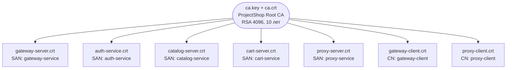
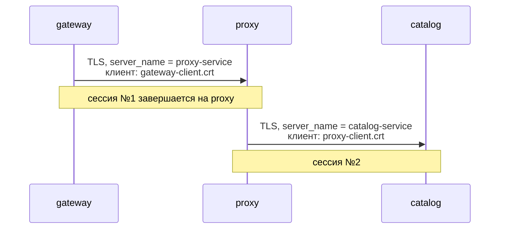

# infra/certs

PKI стенда: один самоподписанный корневой CA и выпущенные им сертификаты сервисов.

⚠️ **Содержимое этого каталога не должно попадать в git.** Здесь лежит приватный ключ CA, которым подписываются все сертификаты платформы.

## Генерация

```bash
./gen-certs.sh
```

Выполнять **до** первого `docker compose up` — каталог монтируется в контейнеры как `/app/certs`.

## Что создаётся



| Файл | Кто использует | Роль |
|---|---|---|
`ca.crt` | все | Проверка сертификата собеседника |
`ca.key` | только скрипт | Подпись сертификатов |
`gateway-server.{crt,key}` | gateway | HTTPS наружу |
`auth-service.{crt,key}` | auth | gRPC-сервер |
`catalog-server.{crt,key}` | catalog | gRPC-сервер |
`cart-server.{crt,key}` | cart | gRPC-сервер |
`proxy-server.{crt,key}` | proxy | Приём соединений от gateway |
`gateway-client.{crt,key}` | gateway, **proxy** | Клиентская идентичность в mTLS |
`proxy-client.{crt,key}` | proxy | Подключение к catalog |

## Серверные и клиентские сертификаты различаются

**Серверные** получают SAN (Subject Alternative Name):

```bash
-extfile <(printf "subjectAltName=DNS:%s,DNS:localhost,IP:127.0.0.1" "$dns")
```

Клиент при подключении сверяет `server_name` из своего конфига с SAN сертификата сервера. Например, gateway подключается к `auth-service:44044` с `auth_tls.server_name: auth-service`, и это имя должно быть в SAN. Дополнительные `localhost` и `127.0.0.1` позволяют обращаться к сервису с хоста, а не только из сети Docker.

Проверка идёт **по SAN, а не по CN** — современные TLS-библиотеки CN игнорируют, и сертификат без SAN будет отклонён с `x509: certificate relies on legacy Common Name field`.

**Клиентские** сертификаты SAN не имеют:

```bash
# SAN не нужен — сервер проверяет только подпись CA.
```

Сервер при `RequireAndVerifyClientCert` проверяет, что цепочка ведёт к доверенному CA. Имя хоста здесь смысла не имеет — клиент не слушает входящие соединения.

## Показательный случай: цепочка через proxy



Именно поэтому в конфиге gateway `catalog_tls.server_name` равен `proxy-service`, а не `catalog-service`, хотя запрос в итоге обслуживает каталог. Прокси терминирует TLS, а не туннелирует его, — иначе он не смог бы считать трафик и вносить задержку.

## Права на файлы

```bash
chmod 644 *.crt
chmod 644 *-server.key *-client.key auth-service.key
chmod 600 ca.key
```

Ключи сервисов сделаны читаемыми всем осознанно: контейнеры работают под непривилегированным пользователем (`USER app` в Dockerfile), чей uid не совпадает с владельцем bind-mount на хосте. При `600` контейнер не смог бы прочитать свой ключ.

`ca.key` остаётся `600` — он не монтируется ни в один контейнер и нужен только скрипту генерации.

Комментарий в скрипте прямо фиксирует, что это компромисс стенда: «644 приемлемо для локального стенда; в проде ключи берутся из Vault и на диск не пишутся».

## Полезные команды

```bash
# посмотреть содержимое сертификата
openssl x509 -in auth-service.crt -noout -text | head -20

# проверить SAN
openssl x509 -in auth-service.crt -noout -ext subjectAltName

# убедиться, что сертификат подписан нашим CA
openssl verify -CAfile ca.crt auth-service.crt

# срок действия
openssl x509 -in gateway-server.crt -noout -dates
```

## Известные проблемы

1. **Каталог не в `.gitignore`.** В корневом `.gitignore` репозитория только `/bugs`. `infra/certs/` сейчас просто неотслеживаемый — то есть один `git add .` отделяет приватный ключ CA от попадания в историю навсегда. Нужны правила:

   ```gitignore
   infra/certs/*.key
   infra/certs/*.crt
   infra/certs/*.srl
   ```

   В [`shop-auth`](../../../shop-auth/.gitignore) и [`shop-gateway-service`](../../../shop-gateway-service/.gitignore) такие правила есть; в `shop-cart` и `shop-proxy` их нет, и там приватные ключи **уже закоммичены**.

2. **Прокси использует клиентский сертификат gateway.** `shop-proxy/config/config.docker.yaml` задаёт `auth_tls.client_cert_file: /app/certs/gateway-client.crt` — для обращения к `shop-auth` переиспользуется идентичность gateway вместо собственной. Со стороны auth эти сервисы неразличимы, поэтому любая авторизация по сертификату становится бессмысленной. Нужен отдельный `proxy-auth-client`.

3. **Один CA на всё.** Любой сертификат, подписанный этим CA, принимается любым сервисом. Авторизации по идентичности вызывающего нет: `shop-cart` принимает `user_id` из метаданных на доверии, поэтому утечка **любого** клиентского ключа даёт доступ к корзине любого пользователя. Разграничение требует либо проверки CN/SAN клиента на стороне сервиса, либо отдельных CA на зону доверия.

4. **Нет отзыва.** Ни CRL, ни OCSP. Скомпрометированный сертификат можно вывести из доверия только перевыпуском CA и перезапуском всех сервисов.

5. **Сертификаты читаются один раз при старте.** Обновление требует перезапуска процесса — ни один сервис не использует `tls.Config.GetCertificate` или `GetClientCertificate` для перечитывания с диска.

6. **Срок 825 дней у сервисных сертификатов** и 10 лет у CA, без какого-либо напоминания об истечении. Для стенда неважно, но процедуры ротации не существует.

7. **`ca.srl` (счётчик серийных номеров)** остаётся в каталоге между запусками; повторный прогон `gen-certs.sh` продолжит нумерацию, но `-CAcreateserial` при отсутствии файла начнёт её заново — возможны сертификаты с одинаковыми серийными номерами от одного CA.
