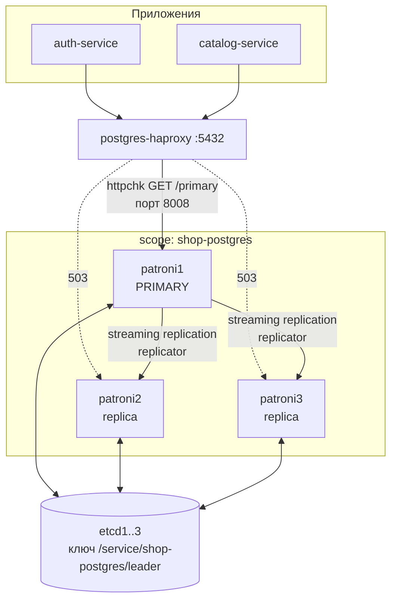

# infra/patroni

Кластер PostgreSQL под управлением Patroni: три узла, автоматический failover, консенсус через etcd.

```text
patroni/
├── Dockerfile              # postgres + patroni + зависимости
├── patroni-entrypoint.sh   # подготовка PGDATA и запуск
└── patroni{1,2,3}.yml      # конфигурации узлов
```

## Устройство



Три роли распределены так:

* **Patroni** — агент рядом с каждым PostgreSQL. Следит за состоянием своего узла, держит или оспаривает лидерство, выполняет promote и rewind.
* **etcd** — распределённое хранилище, где лежит ключ лидера. Решение «кто primary» принимается консенсусом Raft, а не самими узлами БД.
* **HAProxy** — точка входа для приложений. Не участвует в выборах, а опрашивает результат.

## Параметры из конфигурации

```yaml
scope: shop-postgres
namespace: /service/
name: patroni1

restapi:
  listen: 0.0.0.0:8008
  connect_address: patroni1:8008

etcd3:
  hosts: etcd1:2379,etcd2:2379,etcd3:2379

bootstrap:
  dcs:
    ttl: 30
    loop_wait: 10
    retry_timeout: 10
    maximum_lag_on_failover: 1048576
```

| Параметр | Значение | Смысл |
|---|---|---|
`ttl` | 30s | Время жизни ключа лидера. Не продлил — потерял лидерство |
`loop_wait` | 10s | Период цикла проверки состояния |
`retry_timeout` | 10s | Таймаут операций с etcd |
`maximum_lag_on_failover` | 1 МБ | Максимальное отставание реплики, при котором её можно повысить |

Соотношение важно: `ttl` должен превышать `loop_wait` с запасом, иначе узел не успеет продлить ключ между итерациями и получит ложный failover. Практическое правило — `ttl >= 2 × loop_wait + retry_timeout`; здесь 30 против 2×10+10 = 30, то есть ровно на границе.

Время обнаружения отказа определяется этими же значениями: до `ttl` секунд на истечение ключа плюс `loop_wait` на реакцию остальных узлов.

## Параметры PostgreSQL

```yaml
postgresql:
  use_pg_rewind: true
  parameters:
    wal_level: replica
    hot_standby: "on"
    max_wal_senders: 10
    max_replication_slots: 10
    wal_keep_size: 128MB
```

`use_pg_rewind: true` — ключевая настройка для автоматического восстановления. Бывший primary, вернувшийся после сбоя, может содержать транзакции, которых нет у нового лидера (они не успели отреплицироваться). `pg_rewind` откатывает такие расхождения, приводя узел к состоянию нового primary, — без этого узел пришлось бы восстанавливать полным базовым бэкапом.

`wal_keep_size: 128MB` — запас WAL-сегментов, чтобы кратковременно отставшая реплика догнала по streaming replication, а не требовала повторного `basebackup`.

## Инициализация

```yaml
initdb:
  - encoding: UTF8
  - data-checksums
```

`data-checksums` включается только при `initdb` — потом добавить его нельзя без пересоздания кластера. Контрольные суммы страниц позволяют обнаруживать повреждения данных на диске.

Первый запустившийся узел выполняет `initdb` и становится primary; остальные клонируют его через `pg_basebackup`.

Прикладные базы Patroni **не создаёт** — это делает отдельный идемпотентный шаг [`infra/postgres/init.sql`](../postgres/init.sql), запускаемый контейнером `postgres-init`. Причина: `CREATE DATABASE` и `CREATE ROLE` — кластерные операции, а не операции схемы, и держать их отдельно от миграций правильнее.

## Аутентификация

```yaml
authentication:
  superuser:
    username: postgres
    password: postgres
  replication:
    username: replicator
    password: replicator

pg_hba:
  - host all all 0.0.0.0/0 md5
  - host replication replicator 0.0.0.0/0 md5
```

Отдельная роль `replicator` для репликации — принцип минимальных прав: она может только читать WAL, но не работать с данными.

## Работа с кластером

```bash
# состояние
curl -s http://localhost:18008/cluster | jq
curl -s http://localhost:18008/patroni | jq

# кто primary — отвечает 200 только он
curl -i http://localhost:18008/primary
curl -i http://localhost:28008/primary
curl -i http://localhost:38008/primary

# подключение напрямую к узлу
psql -h localhost -p 15432 -U postgres
# подключение через балансировщик (всегда primary)
psql -h localhost -p 5432 -U postgres
```

### Проверка failover

```bash
docker stop patroni1
sleep 10
curl -s http://localhost:28008/cluster | jq '.members[] | {name, role, state}'
docker start patroni1     # вернётся как replica, при необходимости через pg_rewind
```

### Проверка потери кворума

```bash
docker stop etcd2 etcd3
```

Из трёх узлов etcd остаётся один — кворума нет, запись в etcd невозможна. Patroni не может продлить ключ лидера и через `ttl` = 30 секунд **переводит primary в read-only**.

Это не сбой, а корректное поведение: узел, не подтвердивший лидерство через консенсус, обязан прекратить приём записи. Иначе при восстановлении связи оказалось бы два узла, считающих себя primary, с расходящимися данными — split-brain.

Возврат узлов etcd восстанавливает работу автоматически.

Отсюда практический вывод: три узла etcd — минимальная конфигурация, переживающая отказ одного. Потеря двух останавливает запись во всём кластере PostgreSQL.

## Известные проблемы

1. **Репликация асинхронная — failover теряет транзакции.** В `bootstrap.dcs` нет ни `synchronous_mode`, ни `synchronous_commit`, а `maximum_lag_on_failover: 1048576` явно разрешает повысить реплику, отставшую на 1 МБ WAL. Значит, при failover **уже подтверждённые клиенту транзакции могут исчезнуть**. Для `authdb` (пользователи, refresh-сессии) это означает, что успешная регистрация может пропасть.

   Включается так:

   ```yaml
   bootstrap:
     dcs:
       synchronous_mode: true
       synchronous_node_count: 1
   ```

   Цена — запись подтверждается только после получения WAL хотя бы одной репликой, то есть latency растёт. Это осознанный выбор между скоростью и сохранностью, и сейчас он сделан в пользу скорости молча.

2. **`ttl` ровно на границе рекомендуемого.** 30 = 2×`loop_wait` + `retry_timeout`. При замедлении etcd или узла возможен ложный failover. Запас (`ttl: 45`) надёжнее, хотя увеличивает время обнаружения реального отказа.

3. **Нет `pg_stat_statements` и настроек производительности.** `shared_buffers`, `work_mem`, `max_connections` оставлены по умолчанию. При том, что пулы соединений в сервисах тоже не настроены (см. README сервисов), `max_connections` может стать узким местом.

4. **Нет экспортёра метрик PostgreSQL.** `postgres_exporter` в стенде отсутствует, поэтому лаг репликации, число соединений и состояние кластера в Prometheus не попадают. Patroni отдаёт состояние только через свой REST API, который никто не опрашивает, кроме HAProxy.

5. **Нет бэкапов.** `pgBackRest` или `wal-g` не настроены, `archive_mode` выключен. Кластер защищён от отказа узла, но не от логической ошибки — удалённые данные восстановить нечем. Point-in-time recovery невозможен.

6. **`pg_hba` разрешает `md5` с любого адреса.** Для локального стенда приемлемо, но `scram-sha-256` предпочтительнее даже здесь — `md5` считается устаревшим с PostgreSQL 10.

7. **Пароли в конфигурации открытым текстом** — `postgres/postgres` и `replicator/replicator` прямо в YAML.

8. **Три почти одинаковых файла конфигурации.** `patroni1.yml`, `patroni2.yml` и `patroni3.yml` различаются только полями `name` и `connect_address`. Это можно свести к одному шаблону с подстановкой из переменных окружения — Patroni поддерживает конфигурацию через `PATRONI_*`. Сейчас правку общего параметра (например, включение `synchronous_mode`) нужно вносить трижды, и рассинхрон ничем не обнаружится.
