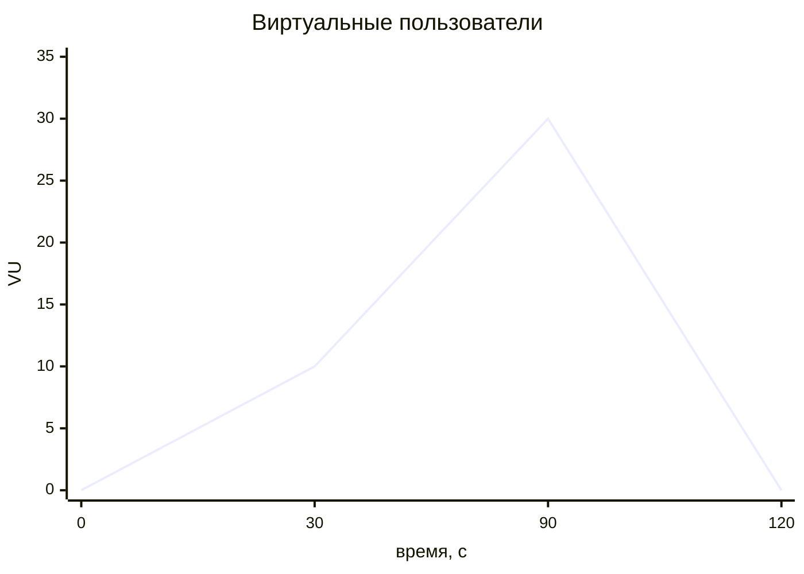

# load

Нагрузочный сценарий для публичного API — [k6](https://k6.io).

```text
load/
└── gateway_smoke.js
```

## Запуск

```bash
k6 run load/gateway_smoke.js

# другой адрес или приложение
BASE_URL=https://127.0.0.1:8083 APP_ID=1 k6 run load/gateway_smoke.js
```

k6 не входит в compose — это внешний инструмент, который ставится отдельно (`brew install k6`, `apt install k6` или через Docker-образ `grafana/k6`).

## Профиль нагрузки

```yaml
stages:
  - { duration: '30s', target: 10 }   # разгон
  - { duration: '1m',  target: 30 }   # плато
  - { duration: '30s', target: 0 }    # снижение
```



Плавный разгон вместо мгновенного выхода на пик даёт системе прогреть кэши, пулы соединений и JIT-компиляцию — резкий старт мерил бы в основном холодный старт.

## Пороги

```yaml
thresholds:
  http_req_failed:   ['rate<0.05']
  http_req_duration: ['p(95)<800']
```

Пороги превращают сценарий из «посмотреть цифры» в автоматическую проверку: при их нарушении k6 завершается с ненулевым кодом, что пригодно для CI.

`p(95)`, а не среднее — среднее скрывает выбросы, а именно они определяют опыт пользователя. `insecureSkipTLSVerify: true` нужен из-за самоподписанного сертификата gateway.

## Подготовка данных

```javascript
export function setup() {
  const suffix = `${Date.now()}-${Math.floor(Math.random() * 100000)}`;
  const username = `k6-${suffix}`;
  // register → login → возврат токена
}
```

`setup()` выполняется один раз до начала нагрузки: регистрирует уникального пользователя и выполняет вход, а возвращённый токен получают все виртуальные пользователи.

Уникальный суффикс из времени и случайного числа нужен потому, что `username` и `email` в `authdb` объявлены `UNIQUE` — фиксированное имя сломало бы второй прогон.

Сценарий проходит полный путь: регистрация → логин → запросы к защищённым эндпоинтам с реальным JWT. Это проверяет и `shop-auth`, и middleware gateway, а не только отдачу статики.

## ⚠️ Rate limiter сработает

Gateway настроен на **100 запросов в минуту с одного IP** (`rate_limit: {limit: 100, window: 1m}`). При 30 виртуальных пользователях этот лимит исчерпывается за секунды, и дальше пойдут `429`, которые k6 засчитает в `http_req_failed` — порог `rate<0.05` будет нарушен.

Варианты:

1. Поднять лимит в [`shop-gateway-service/config/config.docker.yaml`](../../shop-gateway-service/config/config.docker.yaml) на время теста и перезапустить gateway.
2. Проверять именно поведение лимитера — тогда ожидаемым результатом становятся `429`, и порог нужно снять.

Сам факт, что лимитер срабатывает, — полезный результат: он подтверждает, что защита работает. Но измерить пропускную способность системы при включённом лимите нельзя.

## Проверка лимитера отдельно

Без k6, обычным shell:

```bash
for i in $(seq 1 105); do
  curl -k -s -o /dev/null -w "%{http_code}\n" https://localhost:8083/health
done | sort | uniq -c
```

Ожидание — около 100 ответов `200` и остальные `429`. Точное число может отличаться: в текущей реализации лимитера есть дефект, из-за которого запросы в пределах одной миллисекунды считаются как один (см. [`shop-gateway-service/internal/ratelimit/README.md`](../../shop-gateway-service/internal/ratelimit/README.md)).

## Что смотреть во время прогона

| Где | На что |
|---|---|
Grafana `http://localhost:3000` | `gateway_http_request_duration_seconds`, разложение по слоям (`service`, `grpc`) |
Jaeger `http://localhost:16686` | Самые медленные трейсы, где именно теряется время |
`curl http://localhost:8085/metrics` | `proxy_tcp_connections_active`, объём трафика через прокси |
`docker stats` | Потребление CPU и памяти контейнерами |

Ценность стенда в том, что нагрузка прогоняется одновременно с наблюдением по трём сигналам — видно не только «медленно», но и где.

## Сценарии отказов под нагрузкой

Основной способ применения: запустить нагрузку и вмешаться в работу системы.

```bash
k6 run load/gateway_smoke.js &

sleep 20
docker stop patroni1          # failover PostgreSQL

# либо задержка в канале до каталога
curl -X POST -H "Authorization: Bearer $TOKEN" -H "X-App-Id: 1" \
  "http://localhost:8085/admin/faults/delay?ms=500"

# либо отказ primary MongoDB
docker stop mongo1
```

По графикам и выводу k6 видно окно недоступности и скорость восстановления.

## Известные проблемы

1. **Порог конфликтует с rate limiter.** `http_req_failed: rate<0.05` не может быть выполнен при 30 VU и лимите 100 req/min — сценарий гарантированно «падает» не из-за проблем системы. Либо профиль нужно привести в соответствие с лимитом, либо сценарию нужна опция отключения порога.

2. **Один сценарий на всё.** Покрыт только путь регистрация/логин/чтение. Нет отдельных сценариев под запись в корзину (где работает распределённый мьютекс), под SSE-поток `/products/stream` и под поиск. Мьютекс корзины — самая интересная для нагрузки часть системы, и она не тестируется.

3. **`setup()` создаёт одного пользователя на все VU.** Все виртуальные пользователи работают с одним `user_id`, то есть с одной корзиной. Для проверки мьютекса это как раз полезно, но для измерения пропускной способности искажает картину: конкуренция за один замок становится узким местом вместо реальной нагрузки.

4. **Пароль в сценарии захардкожен** — `Test123!`.

5. **Нет очистки.** Каждый прогон оставляет в `authdb` нового пользователя и его refresh-сессии; удаления (`teardown`) нет, а джобы очистки просроченных сессий в `shop-auth` тоже не существует.

6. **k6 не входит в стенд.** В compose его нет, в README платформы до этой правки фигурировала команда `go run . -rate 50 -duration 60s` — от прежнего нагрузочного клиента на Go, которого в репозитории больше нет (остался только пустой `go.mod`). Удобно было бы добавить `grafana/k6` как profile-сервис в compose.
